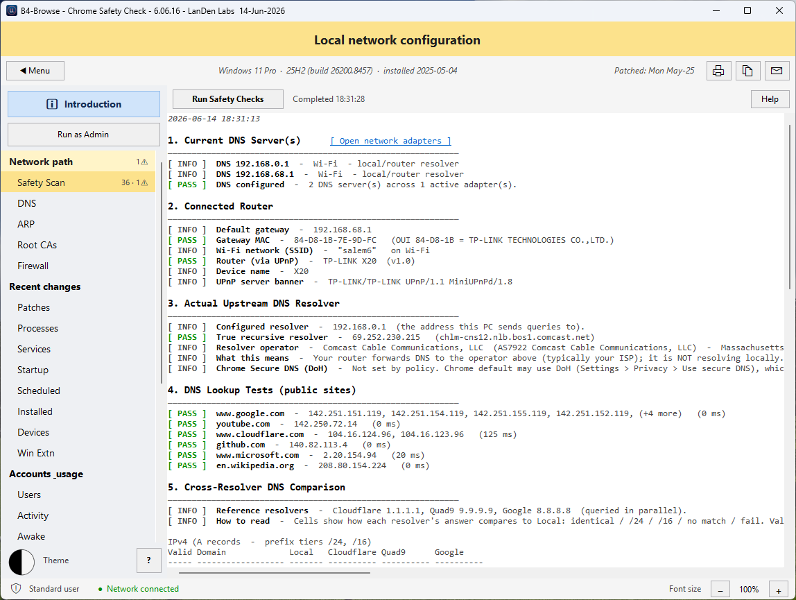
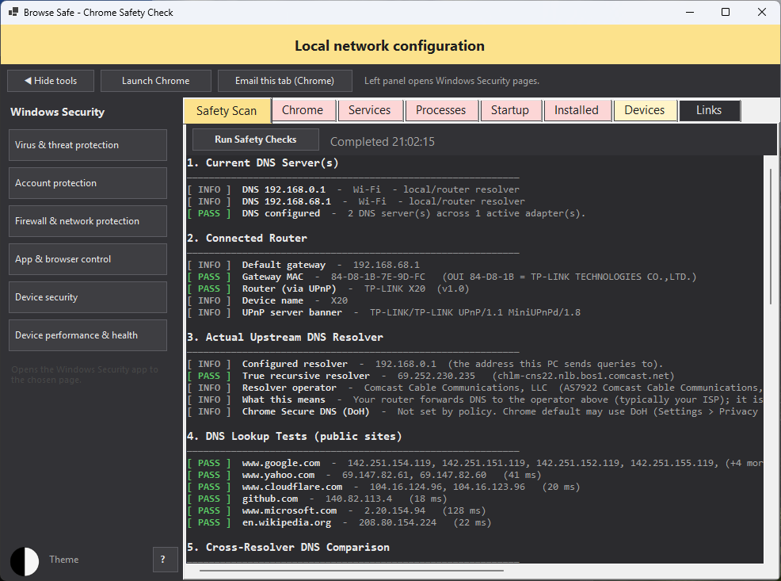
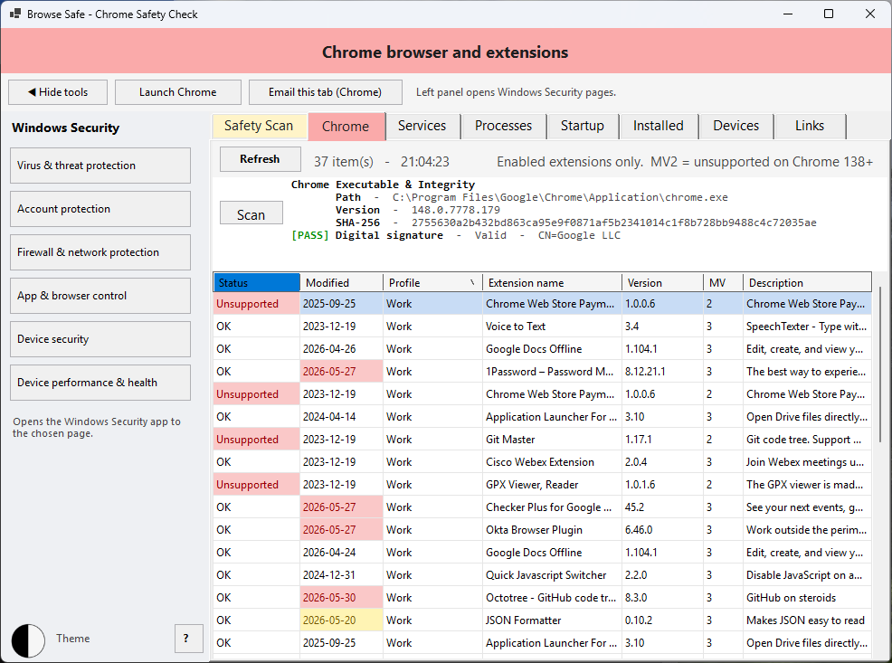
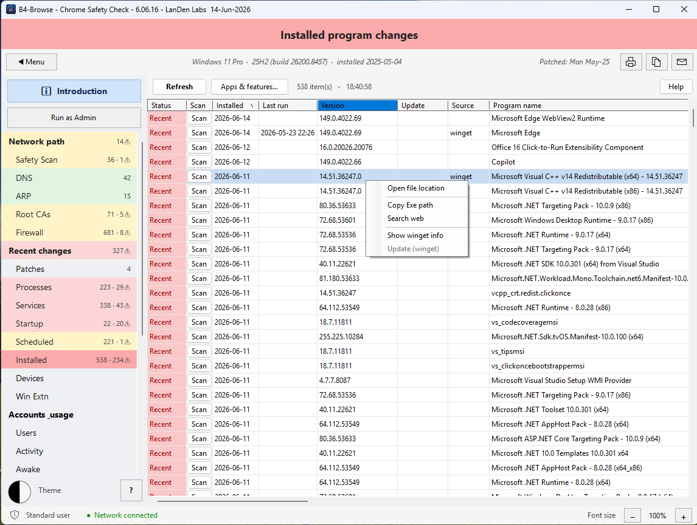
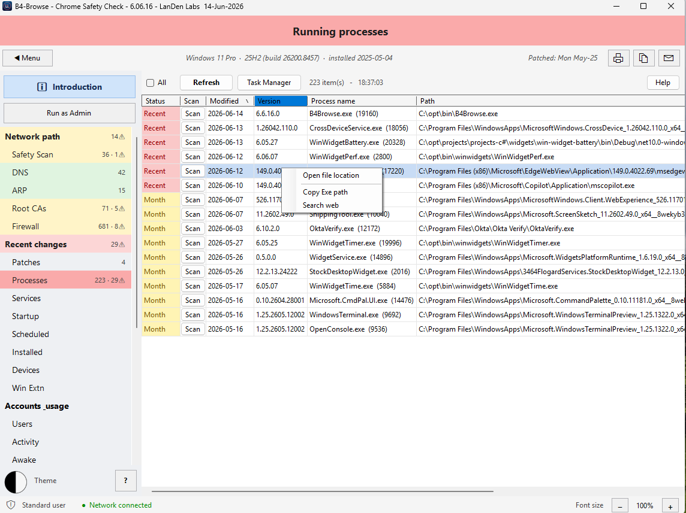
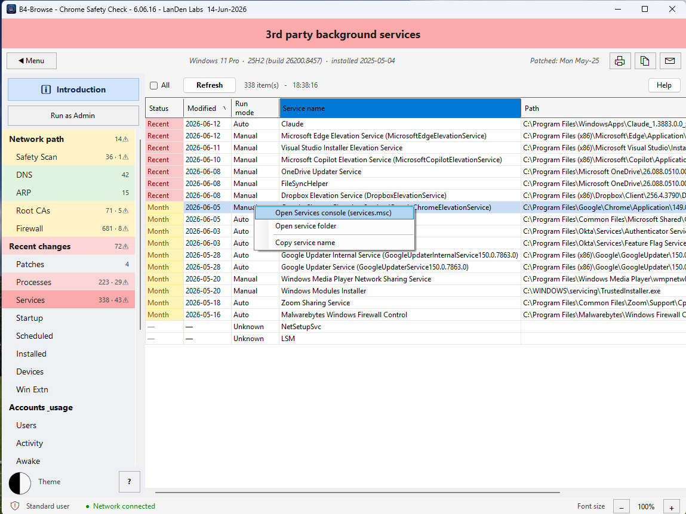
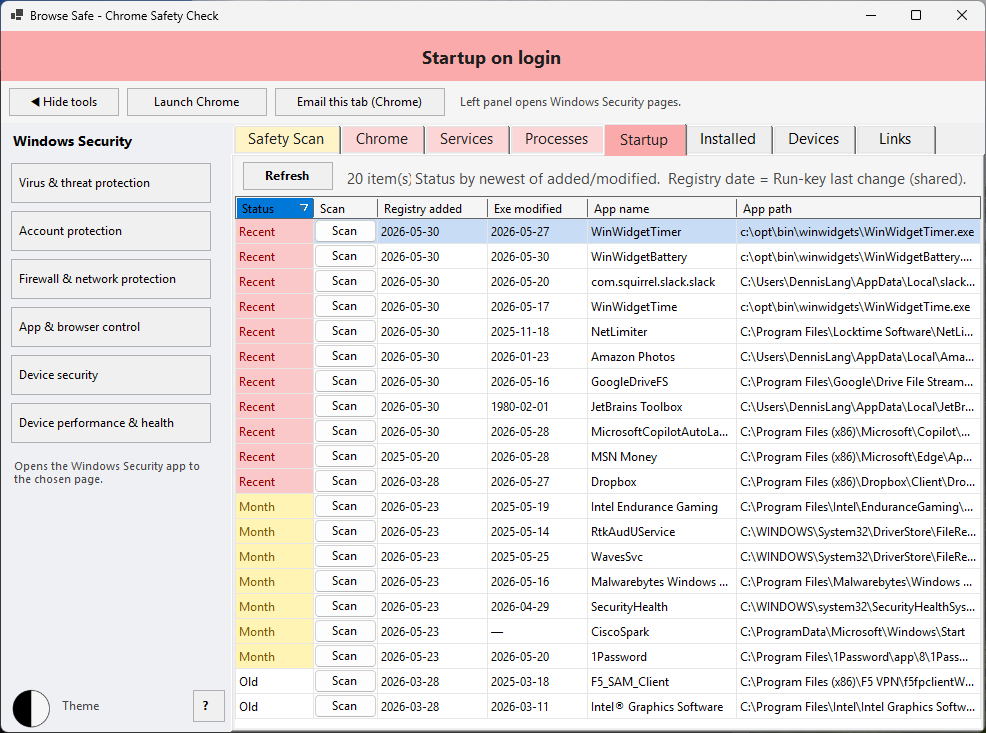
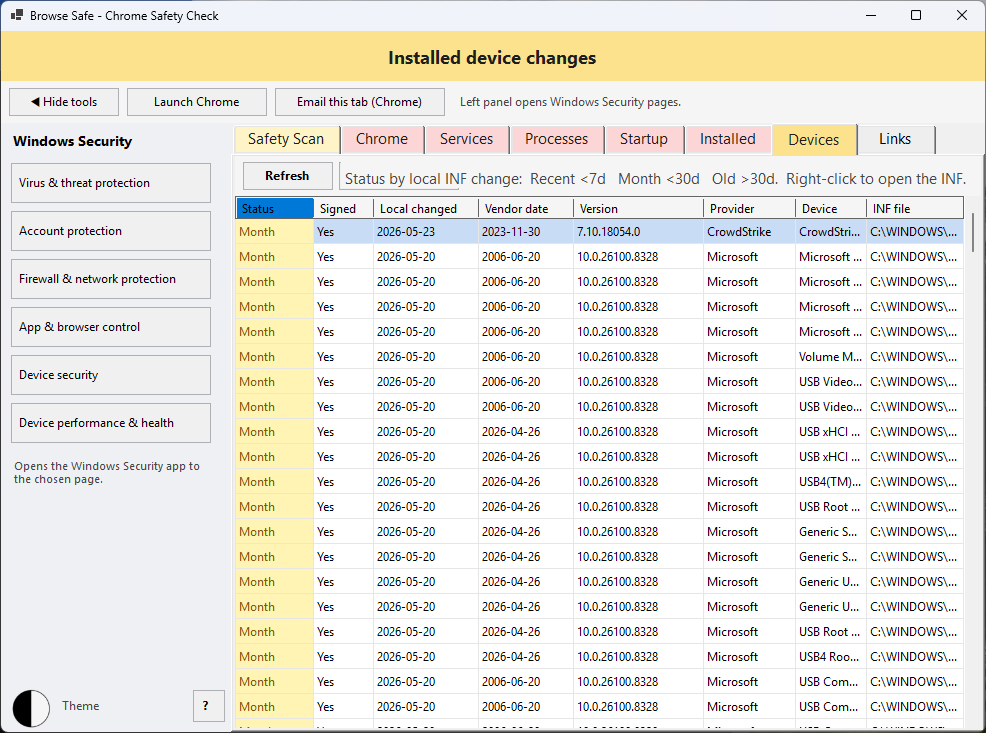
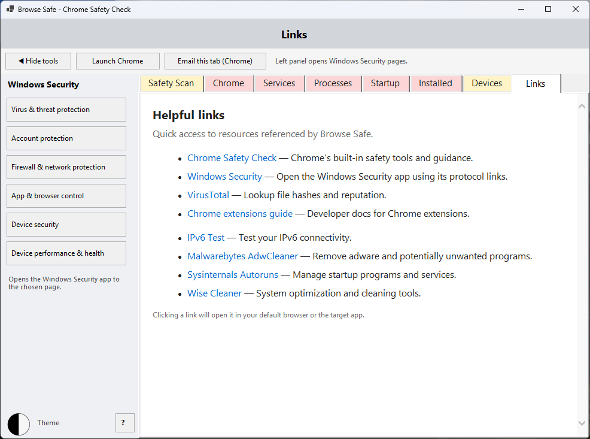
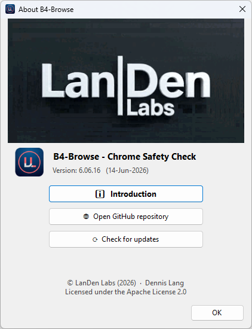

<table border="0">
  <tr>
    <td>
      <!-- VERSION -->v6.11.15<br>
      <!-- DATE -->20-Nov-2026<br>
      Windows<br>
      <a href="https://landenlabs.com/index.html">Home</a>
    </td>
    <td>
      <a href="https://landenlabs.com/index.html">
        
      </a>
    </td>
  </tr>
</table>

# B4-Browse

**B4-Browse** is a small Windows desktop utility that helps you answer two questions before you trust your machine to browse the web:

1. **Is my network configuration safe?** — Confirm there is no rogue proxy in the path and that DNS resolution is not being spoofed or silently redirected.
2. **Has anything changed that shouldn't have?** — Surface files, extensions, programs, processes, services, and drivers that were **modified recently but don't line up with a Windows patch / update date**. A binary that changed last Tuesday when Windows Update didn't run that week is exactly the kind of thing worth a second look.

It runs a Safety Scan on startup and presents its findings in a left-hand navigator grouped into categories — **Network path**, **Recent changes**, **Accounts & usage**, **Protection**, **Browser**, and **Extras**. Each section is sortable and color-coded by its worst finding, and that color rolls up to its category, so anything that needs attention stands out at a glance. Almost everything is read-only: the few actions that change anything (flush the DNS cache, remove an unsupported extension) are clearly labelled and always ask first.

**Quick links:** [Download](#download) · [Privacy policy](https://landenlabs.github.io/win-b4browse/privacy.html) · [Data-collection scripts](scripts/README.md) · [Report an issue](https://github.com/landenlabs/win-b4browse/issues)

---

## Sections at a glance

| Category | Section | What it shows |
| --- | --- | --- |
| **Network path** | Safety Scan | DNS servers, router, actual upstream resolver, proxy, hosts file, DNS lookup and cross-resolver tests, time sync, Windows Security state |
| | DNS | Live Windows resolver cache, with a **Flush DNS cache** button |
| | ARP | Live IPv4 neighbor cache (IP → MAC, with vendor) |
| | Root CAs | Trusted root certificate authorities — an unexpected root can silently intercept HTTPS |
| | Firewall | Firewall profile state, every rule, and any third-party firewall provider |
| **Recent changes** | Patches | Installed Windows updates — the reference date to compare other changes against |
| | Processes | Running processes (optionally only non-Windows ones) |
| | Services | Third-party background services by `.exe` modify date |
| | Startup | Programs that launch at login |
| | Scheduled | Task Scheduler entries, with a hijack audit (Temp paths, LOLBins, hidden tasks) |
| | Installed | Installed program changes, newest first |
| | Devices | Device / driver changes by INF date, signing and vendor |
| | Win Extn | File Explorer shell / context-menu extensions |
| | AppData | Sub-folders of `Local`, `Roaming` and `LocalLow` AppData |
| **Accounts & usage** | Users | Local accounts — enabled Administrator/Guest, hidden, recently-created, dormant |
| | Activity | How often each app has been launched (Windows Search app index) |
| | Awake | Boot / sleep / wake / shutdown / power-loss timeline |
| | Downloads | Bytes each app received and sent (SRUM) ¹ |
| | Events | Significant System, Application and Security event-log entries ¹ |
| **Protection** | Virus | Defender protection state, plus threat and scan history ¹; other registered antivirus products |
| | Restores | System Restore points ¹ |
| | Partitions | All disk partitions incl. hidden EFI/Recovery, Windows RE state, partition-table change history |
| | Env List | System and user environment variables with hygiene checks |
| **Browser** | Chrome | Chrome exe integrity and every installed extension |
| | Settings | Chrome privacy/security settings × profiles, plus enterprise policy |
| **Extras** | Links | Quick references and clean-up tools |
| | Windows Security | Shortcuts into Windows Security pages |
| | History | Run-to-run trend of system counts (one snapshot per day) |
| | About | Version, update check, report an issue — see [About and updates](#about-and-updates) |

¹ Full results need **Run as Administrator** (a button at the top of the navigator relaunches elevated; sections that need it are marked with a dot).

---

## What it checks

### 1. Network safety (Safety Scan)

The Safety Scan inspects the live network configuration and reports each finding as `PASS` / `INFO` / `WARN`:

- **DNS servers** currently configured on each active adapter.
- **Connected router** — gateway, MAC / OUI vendor, UPnP banner.
- **Actual upstream DNS resolver** — the resolver your queries really reach, its operator/ASN, and whether it matches what you expect (catches DNS hijacking / spoofing).
- **Proxy configuration** — flags any system or per-user proxy in the path.
- **DNS lookup tests** against well-known public sites to confirm answers and latency are sane.
- **Cross-resolver DNS comparison** and Windows Security state (time sync, firewall, etc.).



The whole app supports a **light / dark theme** toggle (bottom-left):



### 2. Recent-change detection (inventory sections)

The inventory sections each list items by modification date and tag every row with a **status** so anything unexpected stands out:

| Status | Meaning |
| ------ | ------- |
| **Recent** | Changed within the last **7 days** |
| **Month**  | Changed within the last **30 days** |
| **Old**    | Changed more than **30 days** ago |

The idea is to correlate these dates against your known Windows patch cadence (the **Patches** section): changes that *don't* correspond to an update are the ones to investigate.

- **Chrome** — Chrome's own executable integrity (path, version, SHA-256, Authenticode signature) plus every enabled extension with its profile, version, manifest version (MV2 extensions are flagged as unsupported on Chrome 138+), and description.

  

- **Installed** — installed program changes, newest first.

  

- **Processes** — running processes, with an option to show **only unusual (non-Windows) processes** so signed OS components don't drown out the rest.

  

- **Services** — 3rd-party background services ranked by their `.exe` modify date.

  

- **Startup** — programs that launch at login, by registry-add / executable-modify date.

  

- **Devices** — installed device / driver changes by local INF change date, including signed status and vendor date.

  

- **DNS** — the live Windows resolver cache (`ipconfig /displaydns`): every name recently resolved and the address it returned. A **public-looking host on a non-public (private/loopback) IP** is flagged `Review` — possibly a redirect / captive portal, or legitimate internal / split-horizon DNS. A **Flush DNS cache** button clears the cache (`ipconfig /flushdns`). Note: it's a live snapshot (entries expire per TTL), and Chrome's Secure DNS (DoH) bypasses this cache.

- **Users** — every local user account (`Get-LocalUser`), flagging the ones worth a look: the built-in **Administrator** or **Guest** enabled, an account **hidden** from the sign-in screen, **recently-created** accounts (a classic backdoor / persistence trick — correlate against the Patches date), and **expired-but-enabled** or **dormant** accounts. Shows each account's administrator membership, last sign-in, and expiry. The **Created** date is best-effort: the true time from the Security audit log (event 4720) when run as Administrator, otherwise the profile folder's age as an approximate first-logon proxy — the *Created src* column says which.

- **Partitions** — every disk partition, including the hidden EFI System, Microsoft Reserved and Recovery partitions that File Explorer never shows. Bootkits (Petya, TDL4, BlackLotus, ...) tamper with the boot sector / EFI partition, and ransomware disables or deletes recovery options (`reagentc /disable`, deleting the Recovery partition), so the section flags a **disabled Windows RE**, partitions that were **created, resized, moved or removed** since an earlier run (the app saves a fingerprint of each fixed-disk partition every run, since Windows records no "last changed" time), unrecognised partition types, hidden data partitions, and an EFI / Recovery partition mounted with a drive letter. It also reads Windows' own `Partition/Diagnostic` event log, which records each disk's partition table and MBR at every boot, to report whether the table has changed as far back as the log goes. No administrator rights needed.

### 3. Right-click actions

Several sections let you **right-click a row** to investigate the item directly:

- **Verify signature (WinVerifyTrust)** — runs an Authenticode signature check on the executable and reports the signer.
- **Look up on VirusTotal (by SHA-256, no upload)** — hashes the file locally and opens its VirusTotal report by hash; the file itself is never uploaded.
- **Search the web** for the app/executable name, **copy the exe / INF / extension path**, or jump to the relevant Windows console (Services, Task Manager, Device Manager, Settings).

Rows also expose an inline **Scan** button for the same verify / lookup actions.

### 4. Sharing and help

- **Email / Copy / Print** (toolbar) share the current section as a plain-text report.
- **Introduction** (top of the navigator) and each section's **Help** explain what is shown and how to read it.
- If a background check fails (times out, or returns something unparseable), a **⚠ N errors** badge appears in the status bar; click it for the details.

### Helpful links

A built-in **Links** section collects quick references — Chrome Safety Check, Windows Security, VirusTotal, the Chrome extensions guide, and clean-up / autoruns tools.



---

## About and updates

**About** (the last item in the navigator, or the **?** button next to *Theme*) shows the version, build date and how this copy was installed, plus:

- **Check for updates** — what it does depends on how B4-Browse was installed:
  - **Microsoft Store:** the Store installs updates automatically. The button opens the Store's *Downloads and updates* page; B4-Browse does not contact GitHub.
  - **MSI installer or portable exe:** asks GitHub for the latest release. If a newer version exists, the button becomes **Download** and fetches the matching file (the `.msi` for an MSI install, `B4Browse.exe` for a portable one), with a link to the release notes.

  Nothing is downloaded or installed without your click.
- **Submit issue** — opens the [GitHub issue tracker](https://github.com/landenlabs/win-b4browse/issues).



---

## Download

Windows 10/11, x64. The exe is self-contained: no install or .NET runtime needed.

| Download | What it is |
| --- | --- |
| [B4Browse.exe](https://github.com/landenlabs/win-b4browse/releases/latest/download/B4Browse.exe) | Portable single-file exe: just run it |
| [B4Browse-win-x64-portable.zip](https://github.com/landenlabs/win-b4browse/releases/latest/download/B4Browse-win-x64-portable.zip) | The same exe, zipped |
| [All releases](https://github.com/landenlabs/win-b4browse/releases) | MSI installer, release notes and older versions |

Every release on GitHub is kept, so you can always go back to an earlier version.

---

## Command-line options

Run with no arguments to launch the GUI. The headless modes run the same checks and print a plain-text report to stdout (progress goes to stderr), which is useful for scheduled tasks, logging, or piping to a file:

| Invocation | Effect |
| --- | --- |
| `B4Browse.exe` | Launch the GUI (default). |
| `B4Browse.exe --run <scope>` | Run the checks for `<scope>` headless and print a text report. Defaults to `all` if `<scope>` is omitted. |
| `B4Browse.exe --report` | Alias for `--run scan`. |
| `B4Browse.exe --inventory` | Alias for `--run all`. |
| `B4Browse.exe --out <file>` | Also write the report text to `<file>` (headless modes only). |
| `B4Browse.exe --dump-scripts [dir]` | Save every PowerShell script and external command the app runs, one file per check, to `[dir]` (default `scripts`). See [scripts/README.md](scripts/README.md). |
| `B4Browse.exe --help` | Show usage and exit. Also `-h`, `-?`, `/?`. |

**Scopes:** `scan`, `dns`, `arp`, `rootca`, `firewall`, `patches`, `processes`, `services`, `startup`, `scheduled`, `installed`, `devices`, `winext`, `appdata`, `users`, `activity`, `awake`, `downloads`, `events`, `virus`, `restores`, `partitions`, `env`, `chrome`, `settings`, `history`, `all`.

```bat
B4Browse.exe --run scan
B4Browse.exe --run events --out events.txt
B4Browse.exe --report
```

> Some scopes need Administrator for full results: `events` (Security log), `downloads` (SRUM database), `virus` (Defender threat/scan history), `restores`, and `users` (true account-creation dates). Without elevation they report what they can.

---

## How it collects data

B4-Browse reads local system state with built-in Windows tools (PowerShell, WMI, the registry, event logs and a few system databases). To see exactly what it runs, [scripts/README.md](scripts/README.md) has a snapshot of every PowerShell script and external command, one file per check — or regenerate it yourself with `B4Browse.exe --dump-scripts`.

---

## Building from source

- Requires the **.NET 10 SDK** (`net10.0-windows`).
- Build with Visual Studio (`B4Browse.sln`) or `dotnet build`, then `dotnet run`. The Safety Scan runs automatically on first show.

### Publishing a single-file build

`install.bat` produces a self-contained, single-file executable and copies it to `%binDir%` (default `c:\opt\bin`):

```bat
dotnet publish -c Release -r win-x64 --self-contained true /p:PublishSingleFile=true /p:EnableCompressionInSingleFile=true
```

All runtime assets (icon, brand image, theme icon, links page) are embedded in the exe, so the single file is fully portable.

### Releases and the Microsoft Store

The version lives in one place, `<Version>` in `B4Browse.csproj`; `set-version.ps1` updates it along with `VERSION` and this README, and the app reads it from the assembly at runtime.

Pushing a `v*` tag runs `.github/workflows/publish.yml`, which attaches `B4Browse.exe`, the portable zip, an MSI and an MSIX to a GitHub release. The MSIX (`B4Browse-<ver>-x64.msix`) is built **unsigned**, for direct upload in Partner Center: the Store signs and hosts it, so no download URL is involved. Its identity comes from the repo Actions variables `MSIX_IDENTITY_NAME`, `MSIX_PUBLISHER` and `MSIX_PUBLISHER_DISPLAY_NAME`, which must match Partner Center > Product identity.

---

## Privacy

B4-Browse has no accounts, analytics or telemetry, and your scan results never leave your PC. The [privacy policy](https://landenlabs.github.io/win-b4browse/privacy.html) ([source](docs/privacy.md)) lists every network request the app makes and the few small files it keeps under `%LOCALAPPDATA%\B4Browse`.

## Feedback

Found a bug or have a suggestion? [Open an issue](https://github.com/landenlabs/win-b4browse/issues) — or use **Submit issue** in the app's About dialog.

## License

Licensed under the **Apache License, Version 2.0**. See [LICENSE](LICENSE) for the full text. Third-party components are listed in [THIRD-PARTY-NOTICES.txt](THIRD-PARTY-NOTICES.txt).

## Author

**Dennis Lang** — LanDen Labs (2026)
<https://github.com/landenlabs/win-b4browse>
